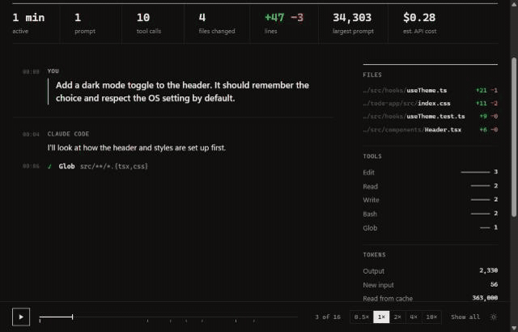

<h1 align="center">agentreplay</h1>

<p align="center">
  <b>Turn any Claude Code or Codex session into a shareable, video-like replay.</b><br>
  One command. One self-contained HTML file. Secrets stripped before you share.
</p>

<p align="center">
  <code>npx agentreplay</code>
</p>

<p align="center">
  <a href="https://dorywoof.github.io/agentreplay/"><b>▶ Try the live demo</b></a>
</p>

<p align="center">
  <a href="https://dorywoof.github.io/agentreplay/"></a>
</p>

---

You just watched an AI agent build a feature in 6 minutes. Now you want to show someone — but all you have is a 4 MB JSONL file nobody can read.

**agentreplay** turns that log into a page that *plays back* the session: prompts, reasoning, every tool call, every diff, with a scrubbable timeline and a summary card that says what it did, how long it took and what it cost.

## Features

- ▶️ **Plays like a video.** Events appear in order with condensed timing; scrub, skip, pause, or change speed. Edits, errors and prompts are marked on the timeline.
- 🤝 **Claude Code *and* Codex.** Auto-detects the format. More agents are on the roadmap.
- 💸 **Cost and token panel.** Input, output and cache tokens, plus an estimated API cost at list prices.
- 🔒 **Safe to share by default.** API keys, tokens, JWTs, private keys, passwords in env assignments, e-mail addresses and your home directory are redacted *before* the HTML is written. The footer says what was removed.
- 📝 **Real diffs.** `Edit`, `Write`, `MultiEdit` and Codex `apply_patch` are shown as red and green diffs, with a per-file `+/-` summary.
- 📦 **One file, zero dependencies.** The output is one HTML file that works offline. Host it anywhere: GitHub Pages, a gist, Slack, e-mail.
- 🌗 Light and dark themes, works on phones, and keyboard shortcuts (`space`, `←` `→`, `Home`, `End`).

## Quick start

```bash
npx agentreplay            # replays your most recent session and opens it
```

```bash
npx agentreplay --list     # pick from recent Claude Code / Codex sessions
npx agentreplay --pick 3
npx agentreplay path/to/session.jsonl -o my-replay.html
```

Requires Node 18+. Nothing is uploaded anywhere: everything happens on your machine.

### Where sessions live

| Agent | Location |
|---|---|
| Claude Code | `~/.claude/projects/<project>/<session>.jsonl` |
| Codex | `~/.codex/sessions/YYYY/MM/DD/rollout-*.jsonl` |

`CLAUDE_CONFIG_DIR` and `CODEX_HOME` are respected.

## Options

```
-o, --out <file>      output HTML path (default: ./replay-<id>.html)
-a, --agent <name>    only look at "claude" or "codex" sessions
-t, --title <text>    override the replay title
    --no-thinking     hide thinking / reasoning blocks
    --no-redact       keep secrets, e-mails and home paths (not for sharing!)
    --keep-paths      redact secrets but keep file paths as-is
    --pricing <file>  JSON with custom $/1M token prices per model
    --json            print the normalized session JSON instead of HTML
    --no-open         don't open the replay in a browser
```

**URL tricks:** add `#e42` to open a replay at event 42, or `?static` to show the whole session at once with no animation.

## Sharing a replay

The output is a static file, so any of these work:

- **GitHub Pages:** commit `replay.html` to a `gh-pages` branch.
- **Gist:** upload it, then open it through a gist-preview service.
- **Netlify / Vercel drop:** drag and drop the file.

> ⚠️ Redaction catches common secret formats, but it can't know everything that is private to you. Skim the replay before posting it publicly.

## About the cost estimate

Cost uses public per-token API list prices (including cache reads and writes) for the Claude models it knows about. If you're on a subscription plan, it shows what the session *would* cost on the API. For models it has no price for (for example Codex models), only token counts are shown. You can supply your own prices:

```json
{ "gpt-6.1": { "input": 1.25, "output": 10, "cacheRead": 0.125 } }
```

```bash
npx agentreplay --pricing prices.json
```

## Roadmap

- [ ] opencode, Gemini CLI and Cursor agent logs
- [ ] Export to GIF / MP4 for social posts
- [ ] Subagent (sidechain) lanes
- [ ] `agentreplay publish`: one-command upload to a gist
- [ ] Combine several sessions into one replay

Ideas and PRs are welcome. Adding a new agent means writing one parser in `src/parsers/` that returns the shared event shape.

## Development

```bash
npm test                     # node:test, no dependencies
node scripts/make-demo.js    # regenerate examples/demo-session.jsonl
npm run demo                 # render examples/demo.html
```

## License

MIT
